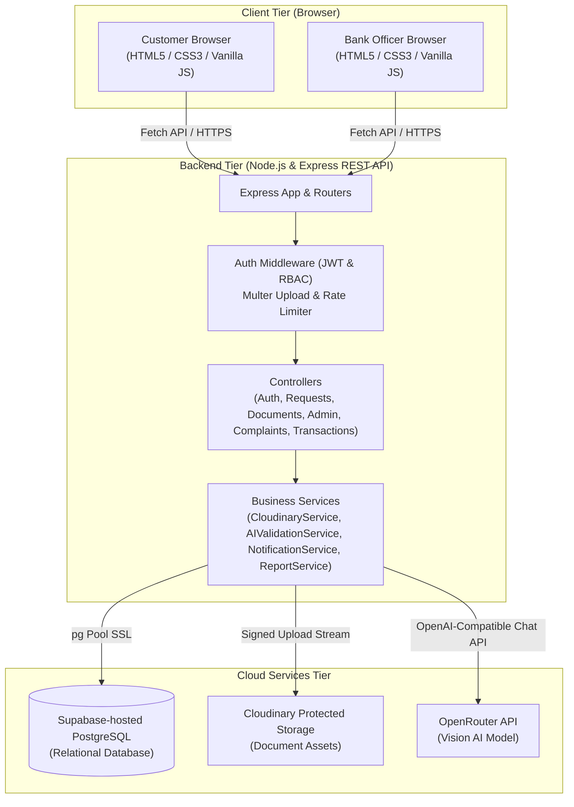
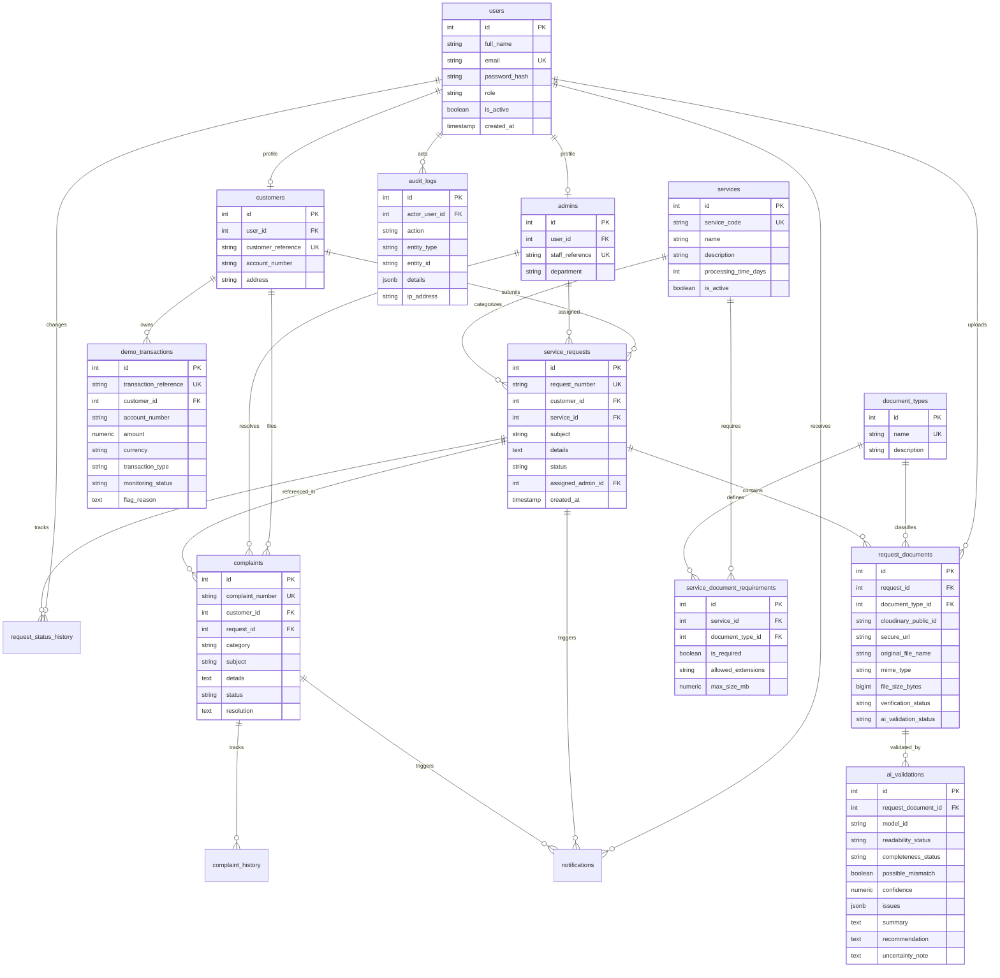
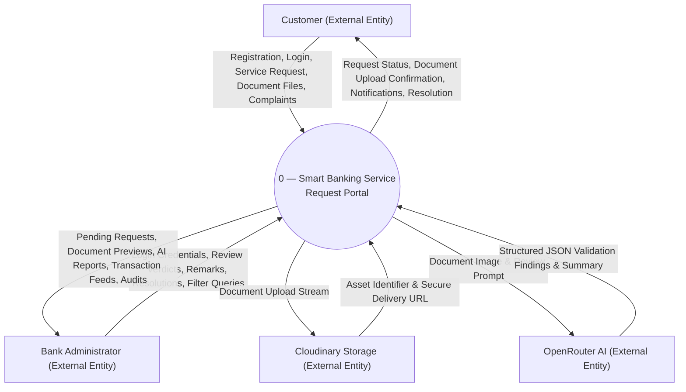
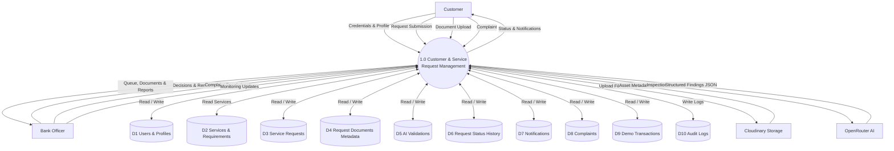
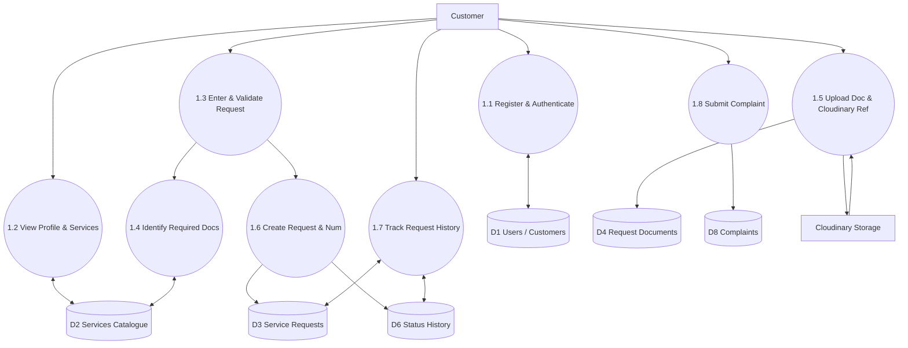
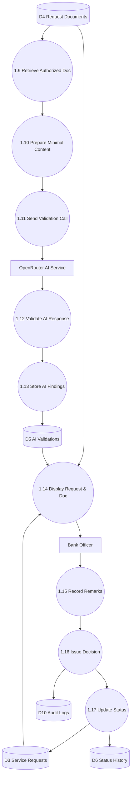
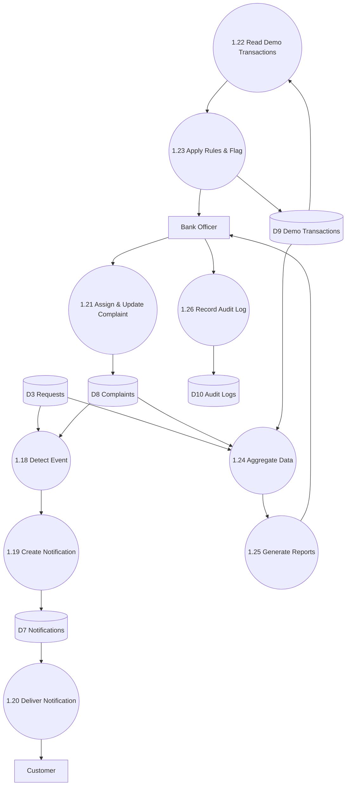
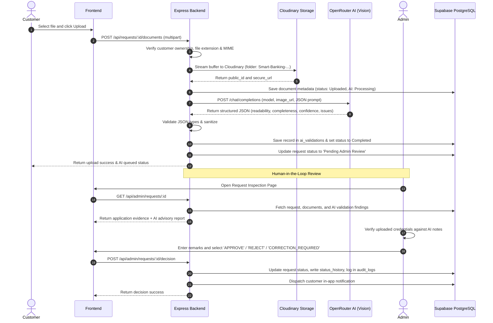

# Academic Diagrams Specification
## Smart Banking Service Request Portal

---

## 1. System Architecture Diagram (Section 22)

---

## 2. Entity Relationship Diagram (ERD — Exactly One, Section 18)

---

## 3. DFD Level 0 — Context Diagram (Section 19)

---

## 4. DFD Level 1 — Main Process 1.0 (Section 20)

---

## 5. DFD Level 2 — Sheet 1: Customer & Request Management (Section 21)

---

## 6. DFD Level 2 — Sheet 2: AI Validation & Admin Review (Section 21)

---

## 7. DFD Level 2 — Sheet 3: Notifications, Monitoring & Reporting (Section 21)

---

## 8. AI Human-in-the-Loop Workflow (Section 27)

