# Academic Diagrams Specification
## Smart Banking Service Request Portal

---

## 1. System Architecture Diagram (Section 22)

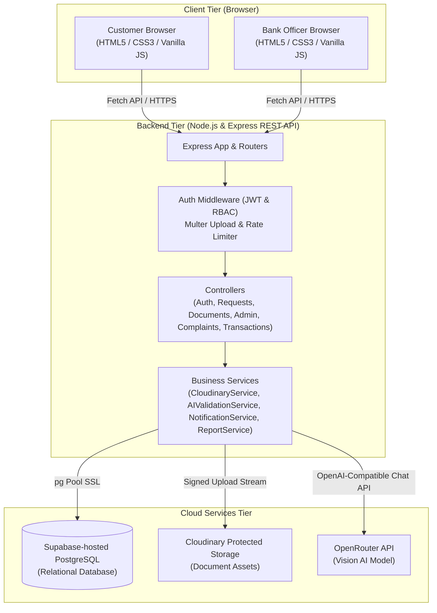

---

## 2. Entity Relationship Diagram (ERD — Exactly One, Section 18)


---

## 3. DFD Level 0 — Context Diagram (Section 19)

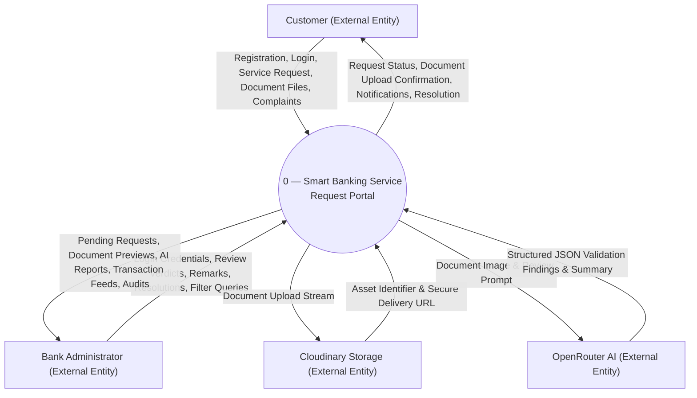

---

## 4. DFD Level 1 — Main Process 1.0 (Section 20)

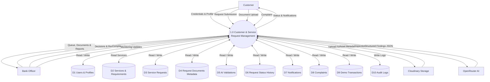

---

## 5. DFD Level 2 — Sheet 1: Customer & Request Management (Section 21)

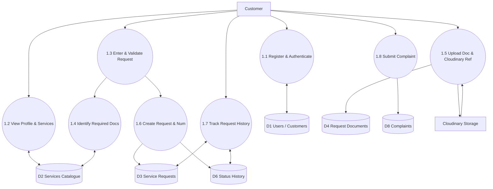

---

## 6. DFD Level 2 — Sheet 2: AI Validation & Admin Review (Section 21)

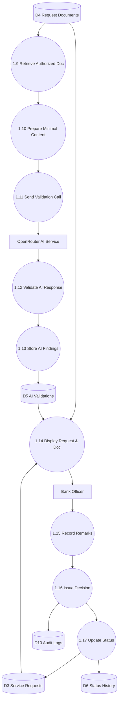

---

## 7. DFD Level 2 — Sheet 3: Notifications, Monitoring & Reporting (Section 21)

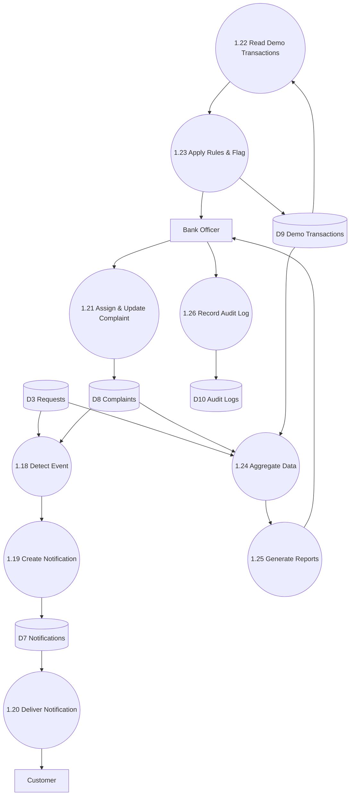

---

## 8. AI Human-in-the-Loop Workflow (Section 27)

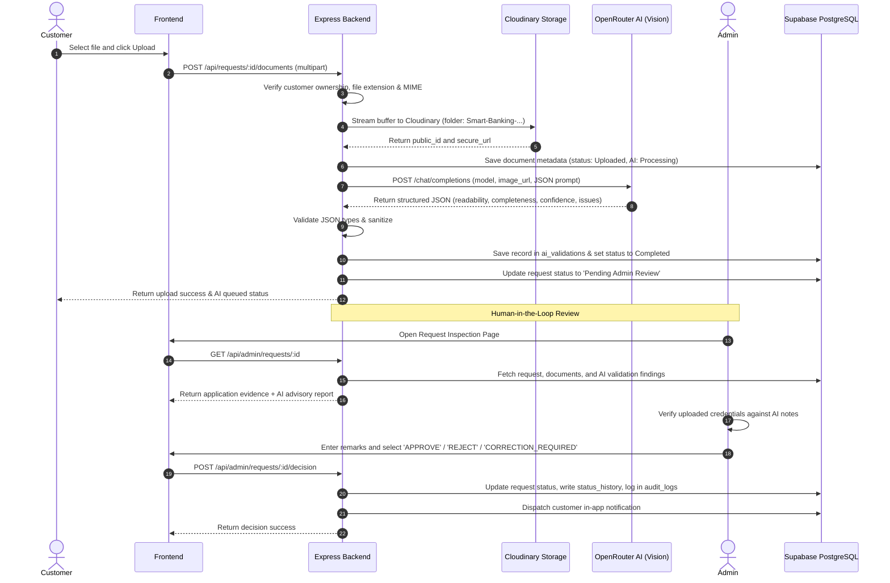


---

## 9. Use Case Diagrams (Section 15 — All 9 Modules)

### 9.1 Authentication & Profile Management
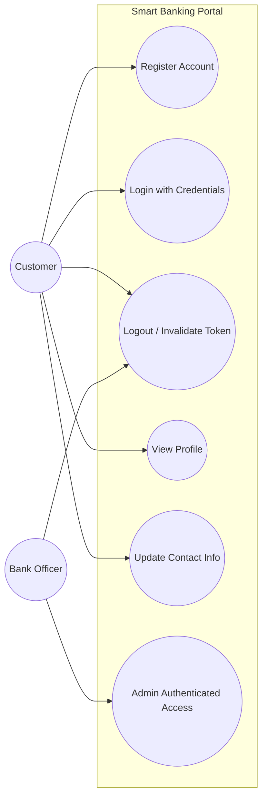

### 9.2 Service Catalogue & Service Requests
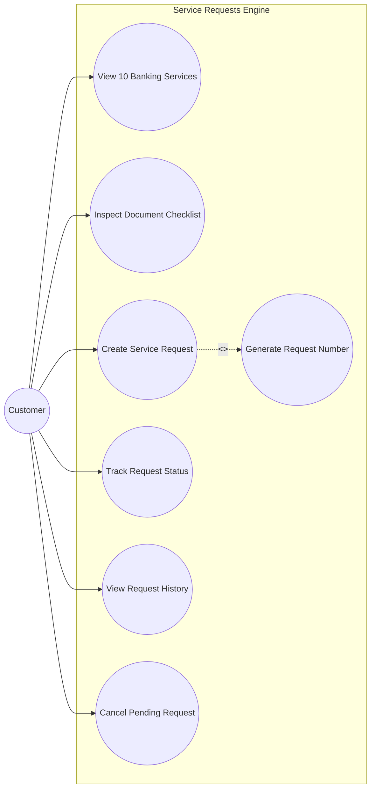

### 9.3 Document Management & Cloudinary Storage
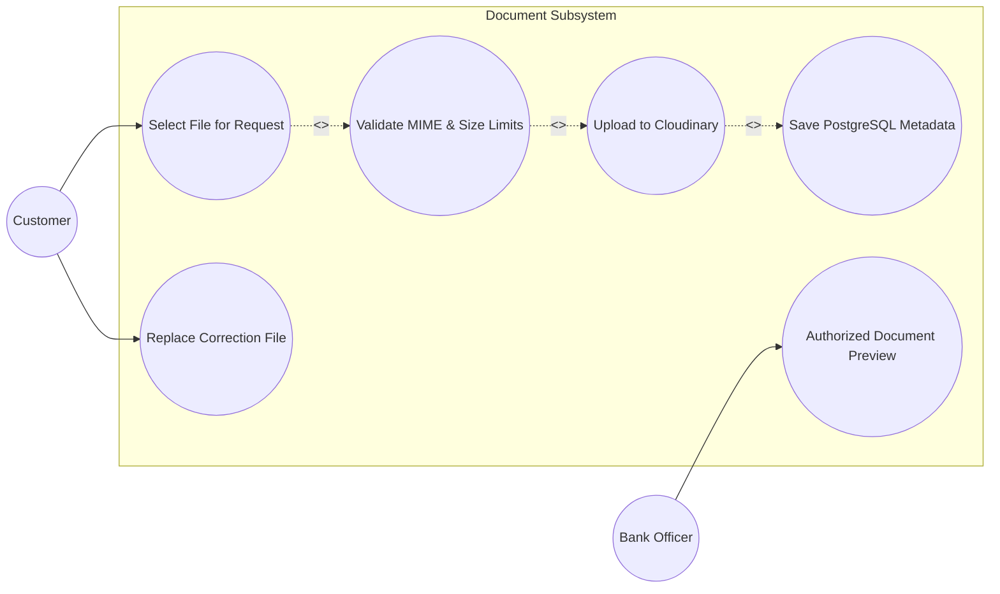

### 9.4 AI-Assisted Document Validation
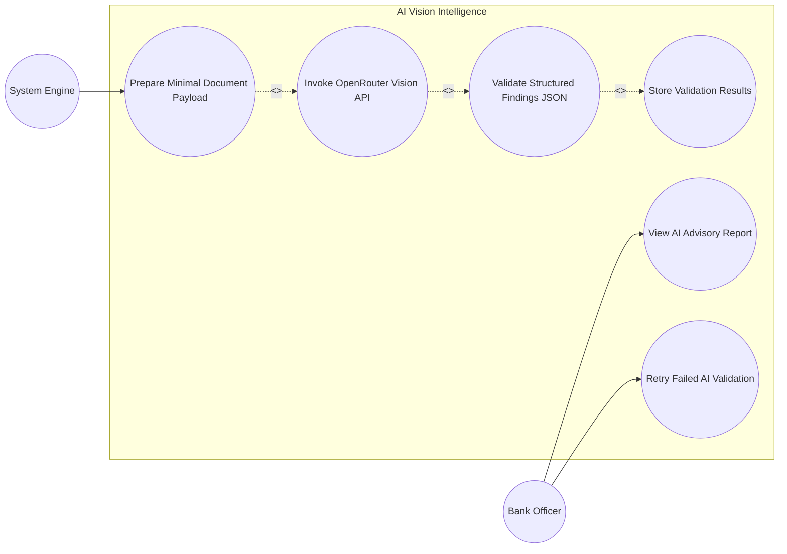

### 9.5 Admin Review & Human Decision
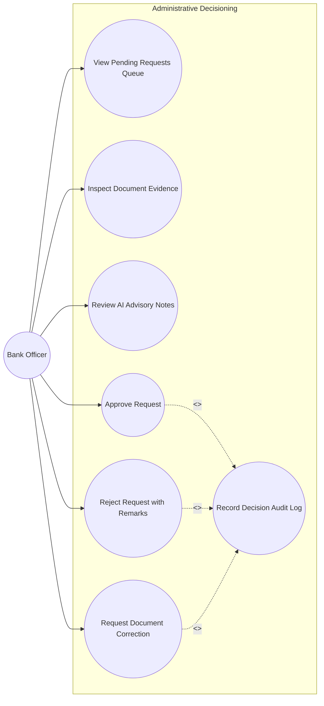

### 9.6 Notifications Subsystem
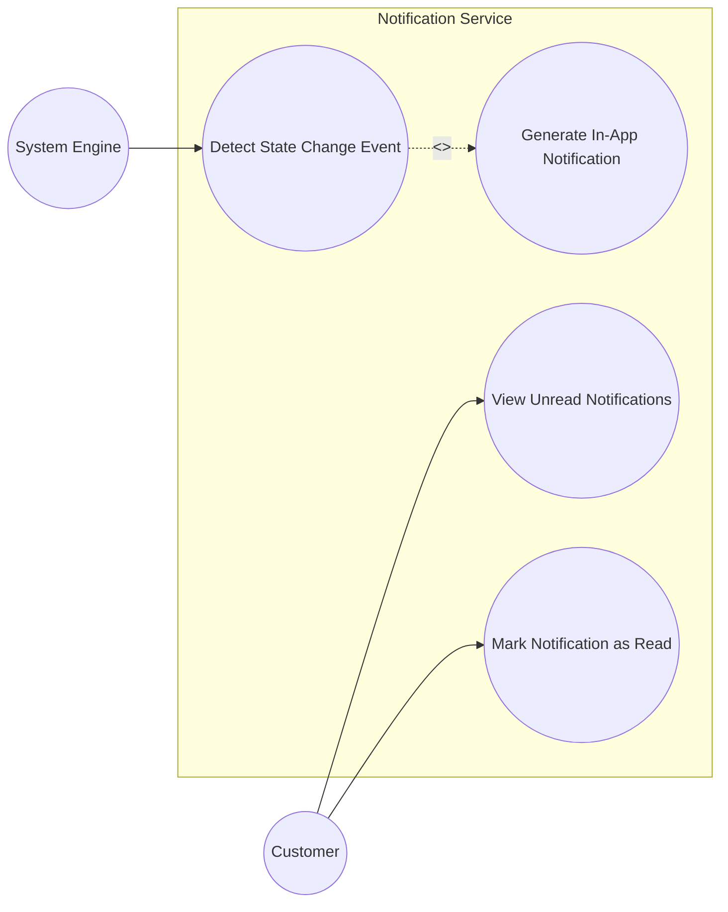

### 9.7 Complaint Management
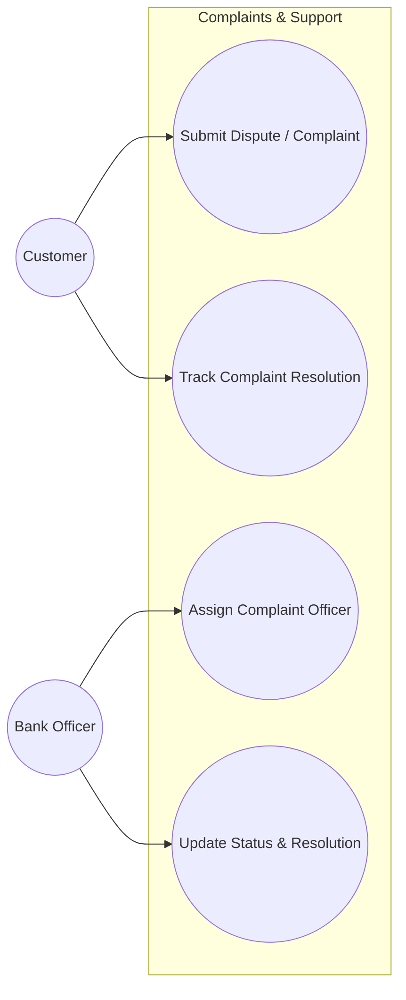

### 9.8 Transaction Monitoring (Academic Demo)
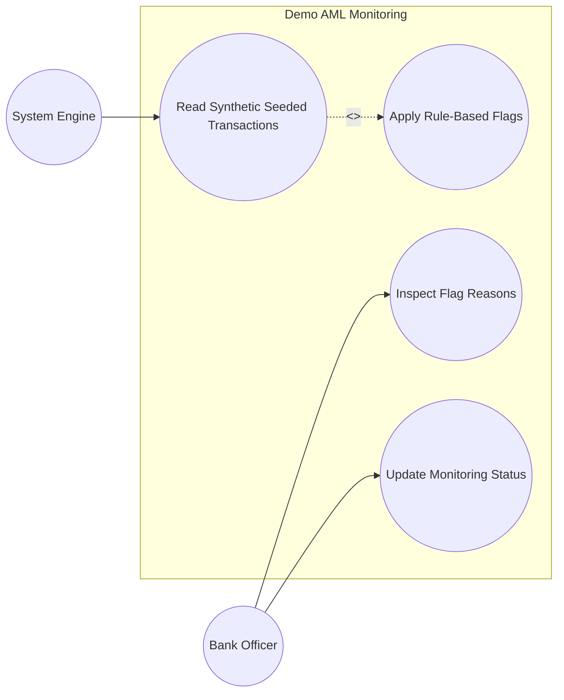

### 9.9 Reports & Audit Logs
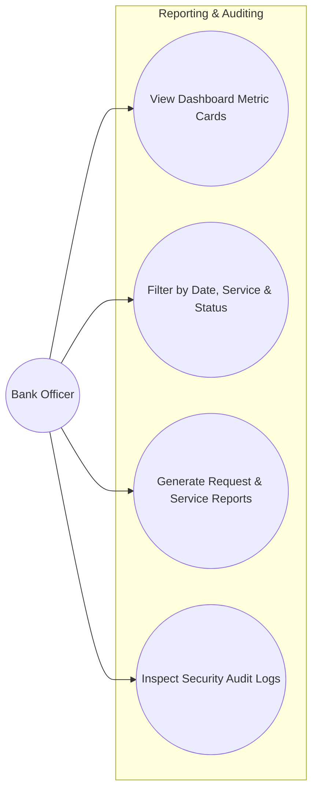

---

## 10. Activity Diagrams (Section 16 — Major Workflows)

### 10.1 Customer Registration & Login Workflow
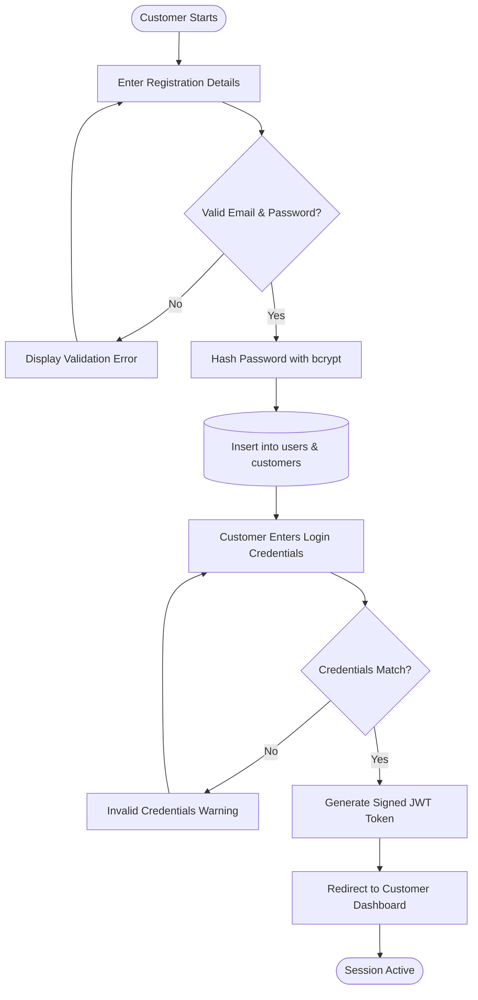

### 10.2 Service Selection & Request Submission
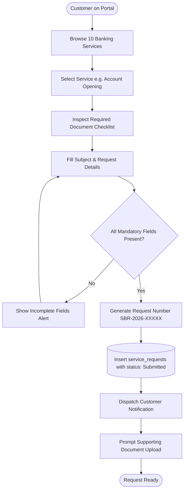

### 10.3 Document Upload & Cloudinary Storage
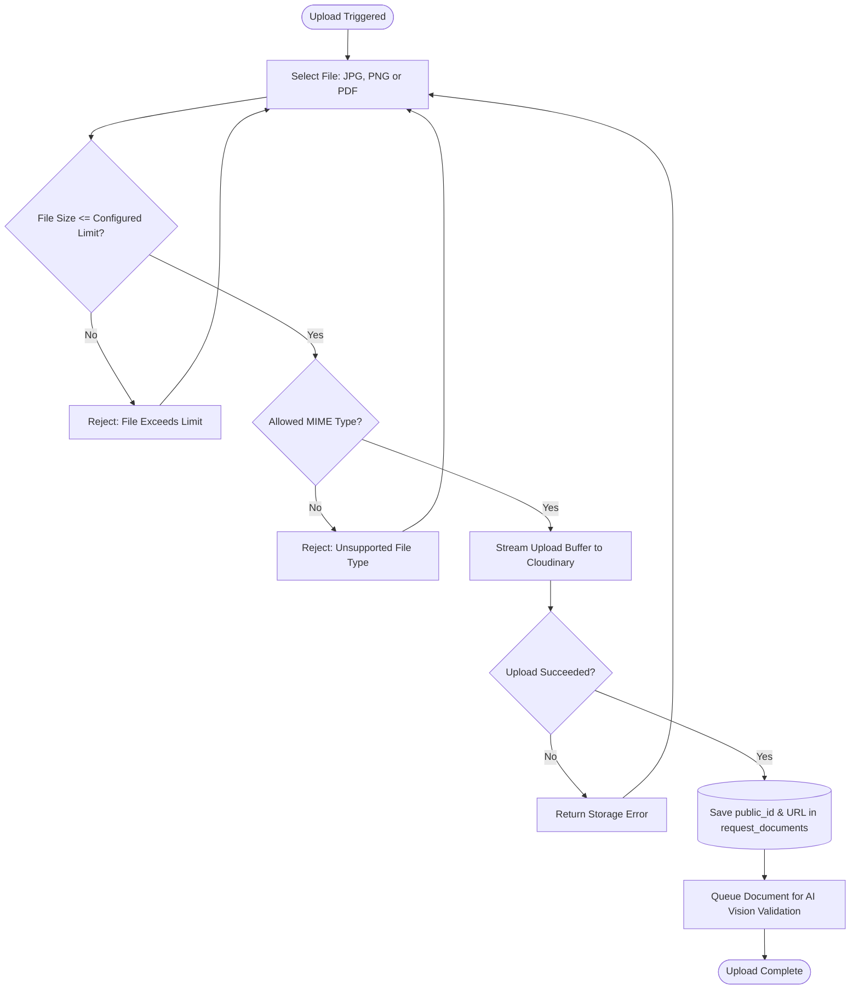

### 10.4 AI-Assisted Document Validation Workflow
```mermaid
flowchart TD
    Start([Document Uploaded]) --> UpdateStatus[(Set ai_validation_status: Processing)]
    UpdateStatus --> PrepPayload[Prepare Secure URL & Structured JSON Schema]
    PrepPayload --> CallAI[POST Call to OpenRouter Vision Model]
    CallAI --> CheckAIResponse{HTTP 200 & Valid JSON?}
    CheckAIResponse -- No --> AIError[Log Provider Error & Set Status: Failed]
    AIError --> Fallback[Enable Manual Review Flag for Admin]
    CheckAIResponse -- Yes --> ValidateSchema[Verify readability, completeness, issues]
    ValidateSchema --> SaveAI[(Store findings in ai_validations table)]
    SaveAI --> UpdateReq[(Update request status to Pending Admin Review)]
    UpdateReq --> Done([Advisory Report Ready for Officer])
    Fallback --> Done
```

### 10.5 Admin Review, Correction, Approval & Rejection
```mermaid
flowchart TD
    Start([Admin Opens Request]) --> ViewEvidence[Inspect Customer Info, Files & AI Notes]
    ViewEvidence --> HumanDecision{Officer Decision?}
    HumanDecision -- Approve --> EnterApproveRemarks[Enter Approval Remarks]
    EnterApproveRemarks --> SetApproved[(Update status: Approved / Completed)]
    HumanDecision -- Correction Required --> EnterFixRemarks[Specify Document Needing Re-upload]
    EnterFixRemarks --> SetCorrection[(Update status: Correction Required)]
    HumanDecision -- Reject --> EnterRejectRemarks[Enter Formal Reason for Rejection]
    EnterRejectRemarks --> SetRejected[(Update status: Rejected)]
    SetApproved --> LogAudit[(Record in audit_logs & status_history)]
    SetCorrection --> LogAudit
    SetRejected --> LogAudit
    LogAudit --> DispatchNotification[Send Immediate In-App Alert to Customer]
    DispatchNotification --> End([Review Concluded])
```

---

## 11. Swimlane Diagrams (Section 17 — Major Workflows)

### 11.1 Document Upload, Cloudinary Storage & AI Review Swimlane
```mermaid
flowchart LR
    subgraph Customer["Customer Lane"]
        C1[Select File & Submit]
        C2[View Upload Progress]
        C3[Receive Status Update]
    end

    subgraph Backend["Express API Backend Lane"]
        B1[Verify User & Ownership]
        B2[Check Extension, MIME & Size]
        B3[Stream File to Cloudinary]
        B4[Save Metadata in Database]
        B5[Call OpenRouter Vision API]
        B6[Validate Structured Findings]
        B7[Notify Admin & Customer]
    end

    subgraph CloudinaryStorage["Cloudinary Storage Lane"]
        S1[Receive Image Stream]
        S2[Store in Protected Folder]
        S3[Return public_id & Secure URL]
    end

    subgraph OpenRouter["OpenRouter AI Lane"]
        A1[Receive Image & Rules Prompt]
        A2[Perform Vision Inspection]
        A3[Return Structured JSON Findings]
    end

    subgraph Database["Supabase PostgreSQL Lane"]
        D1[(Save request_documents)]
        D2[(Save ai_validations)]
        D3[(Update service_requests status)]
    end

    C1 --> B1
    B1 --> B2
    B2 --> B3
    B3 --> S1
    S1 --> S2
    S2 --> S3
    S3 --> B4
    B4 --> D1
    B4 --> B5
    B5 --> A1
    A1 --> A2
    A2 --> A3
    A3 --> B6
    B6 --> D2
    D2 --> D3
    D3 --> B7
    B7 --> C3
```

### 11.2 Admin Review and Decision Swimlane
```mermaid
flowchart LR
    subgraph AdminLane["Bank Administrator Lane"]
        AD1[Open Admin Queue]
        AD2[Inspect Request & Preview Docs]
        AD3[Review AI Uncertainty Report]
        AD4[Submit Decision & Remarks]
    end

    subgraph BackendLane["Express Backend Lane"]
        BK1[Authorize Admin Role]
        BK2[Fetch Application Details & Evidence]
        BK3[Validate Decision Input]
        BK4[Persist Status & Create Audit Entry]
        BK5[Trigger Customer Notification]
    end

    subgraph DBLane["Supabase PostgreSQL Lane"]
        DB1[(Query Requests, Documents & AI)]
        DB2[(Update service_requests status)]
        DB3[(Insert request_status_history)]
        DB4[(Insert audit_logs)]
        DB5[(Insert notifications queue)]
    end

    subgraph CustomerLane["Customer Lane"]
        CU1[Receive In-App Notification]
        CU2[View Updated Application Status]
    end

    AD1 --> BK1
    BK1 --> BK2
    BK2 --> DB1
    DB1 --> BK2
    BK2 --> AD2
    AD2 --> AD3
    AD3 --> AD4
    AD4 --> BK3
    BK3 --> BK4
    BK4 --> DB2
    BK4 --> DB3
    BK4 --> DB4
    BK4 --> DB5
    DB5 --> BK5
    BK5 --> CU1
    CU1 --> CU2
```
